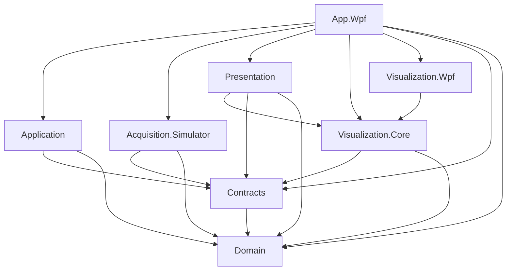

# Arquitectura inicial

Estado: estructura aprobada el 2026-09-09, A/B implementados y almacén autoritativo diseñado en Fase 0
el 2026-10-05. Trazabilidad: R01–R14; ADR 0001–0015.

## Estructura inicial aprobada

La primera sección vertical implementada es simulador -> sesión -> A-Scan neutral -> ViewModel -> ventana WPF. El renderizador reutilizable vive en un octavo proyecto productivo, `UTStudio.Visualization.Wpf`; no se publica como NuGet.

| Proyecto UTStudio.* | Responsabilidad inicial | Referencias directas permitidas |
| --- | --- | --- |
| Domain | Identidades, unidades, configuración y reglas UT; canal físico, elemento, beam y ley focal distintos | Ningún proyecto propio |
| Contracts | Puertos y datos neutrales necesarios para fuente, sesión y comunicación | Domain |
| Application | Casos de uso, sesión activa y coordinación de inicio, parada, cancelación y fallo | Domain, Contracts |
| Acquisition.Simulator | Fuente sintética determinista, tiempo controlable y fallos reproducibles | Domain, Contracts |
| Visualization.Core | Modelo y transformación A-Scan neutrales, sin controles ni renderizador concreto | Domain, Contracts |
| Visualization.Wpf | Control y renderizado A-Scan específicos de WPF | Visualization.Core |
| Presentation | ViewModels, estado observable, coordinación de la transformación visual y servicios UI abstractos | Domain, Contracts, Visualization.Core |
| App.Wpf | Ejecutable, vistas, adaptación WPF y raíz de composición | Los seis proyectos neutrales y Visualization.Wpf |
| Core.Tests | Pruebas neutrales agrupadas por responsabilidad y comprobaciones de arquitectura | Los seis proyectos neutrales; nunca App.Wpf |

Los proyectos neutrales y Core.Tests tendrán objetivo `net10.0`; App.Wpf y Visualization.Wpf, `net10.0-windows`. MSTest 4.0.2 está aprobado/presente desde 2026-09-10; mocking, CI y paquetes adicionales siguen pendientes (Q10).

La flecha A -> B significa que A puede referenciar B; no representa el flujo de datos. Ninguna dependencia inversa se permite por comodidad.

Core.Tests se omite del diagrama productivo. Application publica datos/snapshots mediante Contracts y no conoce Visualization.Core. Presentation coordina la transformación neutral antes de entregar el modelo al ViewModel; esto no obliga al ViewModel ni al hilo UI a procesar cada frame.

La estructura futura conserva esos límites. Los contratos se alojarán en
`UTStudio.Contracts/Inspection`; Fase 1 añadirá `UTStudio.Inspection.Core` como store neutral solo RAM,
dependiente de Domain y Contracts. Application coordina, Visualization.Core consume providers y
App.Wpf compone. No se crea todavía `UTStudio.Inspection.Storage`; el futuro adaptador persistente no
dependerá de Application ni UI. Véase [ADR 0015](../adr/0015-authoritative-inspection-data-store.md).

La [propuesta ADR 0016](../adr/0016-reusable-complete-scan-components.md) y su
[plan](../plans/2026-10-13-reusable-scan-components.md) evalúan componentes completos por scan con
comunes mínimos. Aún no cambian el grafo: el host conservaría hardware, `ApplicationSession` y store;
los componentes consumirían puertos neutrales y preservarían `TraceIdentity`. C-Scan, proyectos y
NuGet permanecen pendientes de decisiones posteriores.

## Contratos y límites

Contracts se organiza conceptualmente en `Acquisition`, `Application`, `Presentation` y `Diagnostics`: fuente y capacidades; casos de uso y sesión; intercambios neutrales compartidos de presentación; estado y contadores diagnósticos, respectivamente. No crear contratos futuros innecesarios ni un proyecto por carpeta. Los modelos A-Scan pertenecen a Visualization.Core; no se duplican en Contracts ni hacen que Contracts lo referencie.

Los puertos exclusivamente UI (navegación, diálogos, selector de archivos, portapapeles y planificación UI) permanecen en Presentation. Contracts/Presentation no es un contenedor de tipos de plataforma.

Dependencias prohibidas: Domain hacia cualquier otro proyecto; Contracts hacia implementaciones; Application hacia adaptadores concretos o presentación; Presentation hacia Application o adquisición concreta; adaptadores de adquisición/almacenamiento hacia Application o UI; cualquier proyecto productivo hacia App.Wpf o tests. Se prohíben ciclos y referencias WPF/Avalonia directas o transitivas en el núcleo y ViewModels. Las referencias a implementaciones desde App.Wpf son para composición, no para acceso directo al hardware desde vistas.

## Comunicación y ciclo de vida
Los casos de uso operan mediante interfaces inyectadas. Los ViewModels no acceden al hardware ni se referencian entre sí; reciben servicios y snapshots de stores mediante IObservable<T> o equivalente. Messenger sirve solo para notificaciones ocasionales de presentación. Frames circulan por ChannelReader<T> de canales acotados.
La sesión pertenece a Application. Cerrar MainWindow solicita salir: cancelar productor mientras el único lector drena, esperar buffers devueltos, desconectar y detener/liberar Host antes del cierre definitivo. MainWindow permanece abierta durante limpieza y diagnóstico tras cinco segundos. Sin bandeja, OnExplicitShutdown ni ejecución sin ventanas. La secundaria B-Scan puede cerrarse sin detener la sesión. Véase [ADR 0006 revisado](../adr/0006-session-window-lifecycle.md).

El [ADR 0007](../adr/0007-frame-source-ownership.md) concreta frame RF `ReadOnlyMemory<short>` y ownership exclusivo; el [ADR 0008](../adr/0008-latest-only-visual-delivery.md) concreta la entrega A-Scan latest-only. El [ADR 0010](../adr/0010-ascan-manual-cursor-measurements.md) añade medidas manuales aproximadas. Los [ADR 0011](../adr/0011-shared-physical-time-viewport.md) y [ADR 0012](../adr/0012-shared-scan-time-navigation.md) definen el viewport temporal neutral. El [ADR 0013](../adr/0013-bscan-bounded-live-visualization.md), refinado por el [ADR 0015](../adr/0015-authoritative-inspection-data-store.md), concreta la proyección B sample-free desde rangos autoritativos, selección exacta emparejada con el raster y ventana secundaria. Cada ViewModel expone binding local; A y B comparten intervalo, no versión visual. No se comparte un ChannelReader entre consumidores. Procesamiento y almacenamiento futuros conservan ramas lossless distintas.

## Frontera WPF/Avalonia
Presentation no importa WPF ni Avalonia. Los servicios UI abstractos permanecen en App.Wpf, separados por carpetas de composición, vistas y servicios. El renderizador A-Scan se extrae a Visualization.Wpf conforme al ADR 0009; no contiene servicios de aplicación ni se inyecta en hardware.
App.Wpf configura Hosting, DI por constructor, configuración y logging, construye las ventanas y coordina arranque/cierre. No es propietario de la lógica de sesión. Los servicios de plataforma no visuales se abstraen en la frontera neutral que los necesita; no se crea un proyecto Platform genérico.

La preferencia visual B-Scan es un servicio singleton explícito de App.Wpf. Lee antes de construir el
ViewModel de ventana y escribe de forma serializada y atómica en la configuración versionada del usuario.
Presentation solo conoce el contrato neutral de escritura y nunca rutas, JSON ni tipos WPF; cada ventana
y su ViewModel conservan lifetime propio, mientras la preferencia sobrevive a reaperturas.
Solo proyectos .Wpf referencian WPF. Tipos UI como Brush, Color, Point, BitmapSource, WriteableBitmap, Dispatcher y Window no aparecen en APIs públicas del núcleo. Usar unidades, coordenadas y formatos de píxel neutrales explícitos.
La raíz App.Wpf compone ViewModels independientes. MainWindow aloja A-Scan y gobierna la salida global. BScanWindow es la primera secundaria: posee ViewModel, suscripciones y consumer ID, toma prestados servicios compartidos y puede cerrarse sin detener sesión. No se crean scopes genéricos ni controles XAML por muestra.
La futura UI Avalonia sustituirá adaptadores y composición. La portabilidad del núcleo no garantiza soporte Linux del SDK PCIe. Aislar también SDK de futuros PLC, robot y encoders.

El B-Scan mantiene la frontera reutilizable: Core define raster/viewports neutrales; Visualization.Wpf
dibuja y emite intenciones; Presentation posee estado y memoria pooled; App.Wpf adapta y posee la
ventana. Los ViewModels A/B no se referencian y comparten coordinadores neutrales.

El [ADR 0014 aceptado](../adr/0014-bscan-selectable-resampling.md) implementa remuestreo 2D reutilizable
sin anticipar C-Scan. `Visualization.Core` aloja por composición modelos pequeños de raster, máscara,
procedencia, firma e interpoladores neutrales; B-Scan conservará formación RF, identidad, ejes y
selección exacta. No se crea aún un proyecto `Scan2D.Core`, una clase base de scans ni un control WPF
universal. La separación en proyecto o una superficie común se reconsiderarán cuando los requisitos
C-Scan aporten un segundo consumidor real.

## Proyectos aplazados y fuentes futuras

No crear todavía SignalProcessing, Storage, Acquisition.GigE, Acquisition.Pcie, Reporting/Reporting.Pdf, PLC, Robot, Avalonia ni 3D. Se aplazan Acquisition.Core, importadores y componentes C/S/D-Scan. El primer incremento B-Scan se implementó por las fases del [plan aprobado](../plans/2026-09-22-bscan-first-increment.md). Cada scan mantiene su propio componente; no habrá un control universal.

GigE, PCIe, simulador y reproducción compartirán un contrato de fuente con capacidades explícitas, sin fingir controles hardware en archivos. GigE encapsulará su protocolo; PCIe, su SDK y memoria. La reproducción comenzará como adaptador de Storage con lectura parcial y ritmo controlable, sin requerir decodificación de paquetes. Importar formatos es una responsabilidad distinta.

SignalProcessing, Storage y Visualization.Core mantendrán dependencias neutrales hacia Domain/Contracts; los adaptadores reales también. Reporting conservará el modelo neutral y Reporting.Pdf será su renderizador separado. Avalonia tendrá composición propia; 3D, PLC y robot se incorporarán mediante límites neutrales y adaptadores cuando exista un caso de uso. PLC y robot no son automáticamente fuentes de muestras UT.

## Autoridad de datos de inspección

El flujo implementado para A y B es fuente común → `ApplicationSession` → `InspectionDataStore` →
providers autoritativos → proyección visual. La sesión notifica solo identidad y revisión confirmadas;
ningún scan recibe memoria prestada desde Application. B-Scan reconcilia mediante
`IInspectionStreamStateProvider`, lee rangos acotados con `IInspectionRangeProvider` y mantiene los
leases solo durante el raster en Visualization.Core. Store es la única autoridad; las vistas conservan
solo presentación y derivados acotados, sin copia RF autoritativa ni `BScanTraceStore`. La selección
B→A usa la `TraceIdentity` exacta publicada. C/S/D y la persistencia incremental permanecen aplazados.

La autoridad publica únicamente trazas committed mediante `InspectionRevision`. Lecturas exactas y por
rango son dispersas, acotadas y revisadas. En Fase 1 no hay expulsión autoritativa ni almacenamiento
frío: al agotar presupuesto hay backpressure o `CapacityExceeded`. El rango confirmado,
el residente caliente, el representado y la región dirty son conceptos distintos. Cerrar una ventana
libera su consumidor, no los datos; cierre global drena admisión, commits y leases antes de liberar.

## Decisiones abiertas y siguiente incremento

Q12: propiedad de la primera secundaria B-Scan resuelta por ADR 0013 y refinada por ADR 0015;
concurrencia de otras inspecciones sigue abierta. Q13: A/B notifican identidad y revisión tras el commit
y consultan la autoridad sin fan-out RF; procesamiento, persistencia y su ownership continúan abiertos.
Q06 conserva datos crudos/procesados y durabilidad.

Pendientes mocking/CI y paquetes adicionales (Q10), renderizadores de otros scans, gates de rendimiento sobre hardware acordado (Q09/Q14) y futuras integraciones. Los modos `None`, `NearestNeighbor`, `Bilinear`, `Bicubic` y `Lanczos`, el selector y la preferencia versionada están implementados conforme al ADR 0014; `None` es predeterminado y Lanczos es alta calidad con cadencia reducida. GP/Kriging permanece como reconstrucción futura separada. ChannelCapacity=4 y BufferCount=8 son internos configurables del simulador sujetos a benchmarks, no del contrato general. Véanse el [plan del primer incremento](../plans/2026-09-09-first-vertical-increment.md), [almacenamiento](storage.md) y [pruebas](testing.md).
